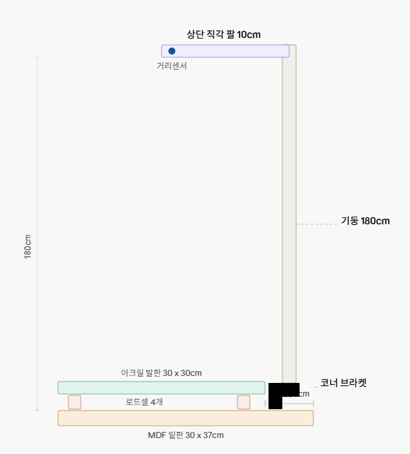

# 쑥쑥이 (Ssukssuki)

유치원/어린이집 아동 성장 측정 무인 키오스크 시스템 — IT-Competition-2026

## 시스템 아키텍처

```
┌─────────────┐      RFID 태그       ┌──────────────┐
│    아동     │ ──────────────────▶ │   ESP32 키오스크  │
└─────────────┘                     │  (RC522/센서)   │
                                     └───────┬──────┘
                                             │ HTTP REST
                                             ▼
                                     ┌──────────────┐
                                     │   Firebase    │
                                     │  Realtime DB  │
                                     └───────┬──────┘
                                             │ Cloud Functions
                                             │ (백분위 계산/FCM)
                                             ▼
                                     ┌──────────────┐
                                     │  학부모 Android  │
                                     │      App      │
                                     └──────────────┘
```

## 하드웨어 설계도



